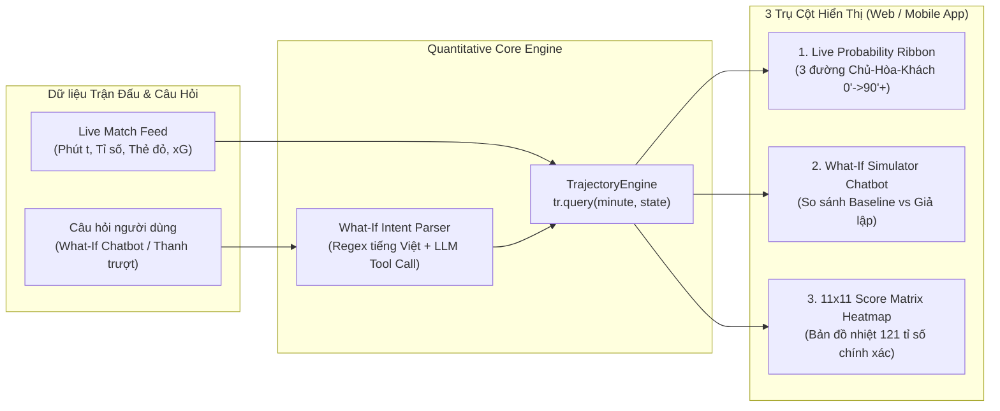

# ⚽ Master Plan: Live Match Win-Probability & "What-If" Simulator

> **Tài liệu quy hoạch tổng thể (Master Architecture & Implementation Plan)** cho ứng dụng phân tích xác suất thắng trực tiếp (Live Win-Probability), biểu đồ nhiệt tỉ số 11×11 và giả lập kịch bản tương lai ("What-If" Simulator) dành cho người xem bóng đá trên nền tảng Web & Mobile.

---

## 📑 Danh Mục Tài Liệu Quy Hoạch Chi Tiết (`docs/plan/`)

Để đảm bảo kiến trúc rõ ràng và dễ dàng triển khai theo từng phân hệ, toàn bộ kế hoạch xây dựng ứng dụng được chia thành **6 tài liệu chuyên sâu** dưới đây:

1. **[01_TECH_STACK_AND_ARCHITECTURE.md](docs/plan/01_TECH_STACK_AND_ARCHITECTURE.md)**
   - Lựa chọn công nghệ (Frontend Web/Mobile, Backend Python Quantitative Engine, AI/NLP Chatbot, Real-time Streaming, Database).
   - Kiến trúc tổng thể hệ thống (System Architecture Diagram).
2. **[02_MATHEMATICAL_LOGIC_AND_ENGINE.md](docs/plan/02_MATHEMATICAL_LOGIC_AND_ENGINE.md)**
   - Mô hình toán học đằng sau ứng dụng (Time-Inhomogeneous Poisson, Dixon-Coles, Continuous-Time Markov Chain cho thẻ đỏ).
   - Đặc tả kỹ thuật hàm cốt lõi `tr.query(minute, ...)` (`TrajectoryEngine`).
   - Toán học tính Ma trận nhiệt tỉ số chính xác $11 \times 11$ ($0\text{–}10 \times 0\text{–}10$) và 3 đường xác suất Chủ – Hòa – Khách.
   - Cơ chế bóc tách ngôn ngữ tự nhiên (NLP Intent Parser) kết hợp `tr.query(minute)` cho Chatbot "What-If".
3. **[03_FEATURES_AND_OPERATION_FLOW.md](docs/plan/03_FEATURES_AND_OPERATION_FLOW.md)**
   - Đặc tả chi tiết 3 tính năng trụ cột:
     1. **Live Probability Ribbon & Momentum Chart** (Phút $0 \to 90+$, icon Bàn thắng / Thẻ đỏ).
     2. **"What-If Simulator" Chatbot & Interactive Scenario Builder**.
     3. **11×11 Exact Score Matrix Heatmap**.
   - Luồng vận hành thời gian thực (Real-time Operation Flow) từ lúc bóng lăn đến khi kết thúc trận đấu.
4. **[04_IMPLEMENTATION_ROADMAP.md](docs/plan/04_IMPLEMENTATION_ROADMAP.md)**
   - Lộ trình xây dựng ứng dụng qua 6 giai đoạn (Phases) từ Quantitative Core Engine $\to$ Backend API & Chatbot $\to$ Frontend Visualization $\to$ Mobile Packaging & Testing.
5. **[05_DEPLOYMENT_AND_DISTRIBUTION.md](docs/plan/05_DEPLOYMENT_AND_DISTRIBUTION.md)**
   - Hướng dẫn triển khai (Cloud Deployment) và đóng gói ứng dụng (PWA + Capacitor Native APK/IPA) để người dùng cuối có thể **tải về điện thoại hoặc mở dùng trực tiếp**.
6. **[06_PROJECT_FILE_STRUCTURE.md](docs/plan/06_PROJECT_FILE_STRUCTURE.md)**
   - Danh sách toàn bộ các file và thư mục cấu thành dự án (kèm giải thích vai trò từng file), đã được khởi tạo sẵn bộ khung (skeleton) trong repository.

---

## 🎯 1. Tóm Tắt Ý Tưởng & Giá Trị Cốt Lõi

Khi xem trực tiếp một trận bóng đá, người hâm mộ thường đặt ra những câu hỏi cảm tính:
- *"Đội nhà đang dẫn 1-0 ở phút 60 nhưng vừa bị thẻ đỏ, liệu khả năng giữ được 3 điểm còn bao nhiêu %?"*
- *"Nếu đội khách bất ngờ gỡ hòa ở phút 65 thì cán cân thắng/thua đảo chiều mạnh cỡ nào?"*
- *"Nếu tử thủ giữ nguyên tỉ số 1-0 này từ phút 60 đến phút 75 thì xác suất thắng tăng từ 68% lên bao nhiêu %?"*

Ứng dụng **Live Match Win-Probability & "What-If" Simulator** biến các mô hình định lượng xác suất bóng đá chuyên sâu thành trải nghiệm trực quan, tương tác tức thì ngay trên màn hình điện thoại hoặc trình duyệt của người xem:



---

## 🛠️ 2. Tổng Quan Tech Stack Đề Xuất

| Tầng (Layer) | Công nghệ lựa chọn | Lý do lựa chọn |
| :--- | :--- | :--- |
| **Quantitative Engine** | **Python 3.11+, NumPy, SciPy** | Xử lý ma trận xác suất $11 \times 11$, phân phối Poisson/Dixon-Coles, tích chập (Convolution) và Markov Chain dưới `2ms`/truy vấn. |
| **Backend & Real-time** | **FastAPI + WebSockets (ASGI / Uvicorn)** | Hiệu năng cao, hỗ trợ đẩy dữ liệu xác suất từng giây (Live Ticker) qua WebSocket và cung cấp REST API cho Chatbot. |
| **What-If Chatbot NLP** | **Hybrid Parser (Rule-based Tiếng Việt + OpenAI/Gemini Function Calling)** | Vừa bắt nhanh các mẫu câu hỏi phổ biến với độ trễ `<10ms`, vừa xử lý linh hoạt mọi câu hỏi ngôn ngữ tự nhiên phức tạp để gọi hàm `tr.query(minute)`. |
| **Frontend (Web UI)** | **Next.js (React 19) + TypeScript + Tailwind CSS** | Giao diện mượt mà, hỗ trợ SSR/PWA, tối ưu cho màn hình dọc điện thoại khi vừa xem bóng đá vừa mở app. |
| **Data Visualization** | **Apache ECharts / Visx (D3.js) + Framer Motion** | Render mượt biểu đồ 3 đường (Ribbon) có custom markers (⚽, 🟥) và Heatmap $11 \times 11$ (121 ô) chuyển màu động theo thời gian thực. |
| **Mobile App Packaging** | **PWA (Service Worker) + Capacitor (iOS / Android)** | Cho phép người dùng **tải trực tiếp file `.apk`** trên Android, cài qua **Add to Home Screen (PWA)** không cần qua chợ ứng dụng, hoặc xuất bản lên App Store / Google Play từ chung 1 codebase. |
| **Cache & Database** | **Redis (In-memory) + PostgreSQL (Supabase/Neon)** | Redis lưu ma trận pre-computed `tr.query()` theo từng phút để phản hồi tức thì (`<1ms`); PostgreSQL lưu lịch sử trận đấu và sự kiện. |

---

## 🧮 3. Tóm Tắt Logic Đằng Sau Hàm `tr.query(minute)`

Trái tim của hệ thống là đối tượng `tr` (`TrajectoryEngine` / `TimeRemainingModel`), cung cấp phương thức truy vấn:

```python
result = tr.query(
    minute=65,
    home_goals=1,
    away_goals=1,
    home_reds=0,
    away_reds=0,
    added_time=4
)
```

Khi gọi `tr.query(minute, ...)`, hệ thống thực hiện 4 bước toán học:
1. **Tính cường độ ghi bàn còn lại ($\Lambda_H, \Lambda_A$)**: Tích phân tốc độ ghi bàn tức thời $\lambda_H(u), \lambda_A(u)$ từ phút `minute` đến hết trận $T = 90 + \text{added\_time}$, có nhân hệ số điều chỉnh thẻ đỏ ($\gamma_{red}$) và tâm lý thi đấu (Game-state effect).
2. **Sinh ma trận xác suất bàn thắng ghi thêm $\Delta S \in \mathbb{R}^{11 \times 11}$**: Áp dụng phân phối Poisson hai chiều có hiệu chỉnh tương quan tỉ số thấp Dixon-Coles $\tau_{\rho}(\Delta g_H, \Delta g_A)$.
3. **Tịnh tiến theo tỉ số hiện tại $(g_H, g_A)$**: Dịch chuyển ma trận theo số bàn thắng đã có để thu được **Ma trận nhiệt tỉ số cuối trận $M \in \mathbb{R}^{11 \times 11}$** (tỉ số từ $0\text{–}0$ đến $10\text{–}10$, với phần đuôi $\ge 10$ gom vào biên $10$).
4. **Tổng hợp xác suất Chủ – Hòa – Khách ($P_H, P_D, P_A$)**:
   - **Chủ thắng ($P_H$)**: Tổng các ô dưới đường chéo chính ($i > j$).
   - **Hòa ($P_D$)**: Tổng các ô nằm trên đường chéo chính ($i = j$).
   - **Khách thắng ($P_A$)**: Tổng các ô trên đường chéo chính ($i < j$).

> Xem công thức toán học đầy đủ và giải thuật chi tiết tại **[02_MATHEMATICAL_LOGIC_AND_ENGINE.md](docs/plan/02_MATHEMATICAL_LOGIC_AND_ENGINE.md)**.

---

## 📂 4. Cấu Trúc Thư Mục Dự Án (Đã Khởi Tạo Trong Repo)

Toàn bộ các file mã nguồn khung (skeleton) đã được tạo sẵn trong repository theo cấu trúc chuẩn Monorepo:

```text
football_app/
├── PLAN.md                                      # Tài liệu Master Plan (File hiện tại)
├── README.md                                    # Giới thiệu dự án
├── docker-compose.yml                           # Chạy trọn bộ Backend + Frontend + Redis
├── .gitignore                                   # Cấu hình bỏ qua file tạm
├── docs/
│   └── plan/                                    # Bộ 6 tài liệu quy hoạch chi tiết
│       ├── 01_TECH_STACK_AND_ARCHITECTURE.md
│       ├── 02_MATHEMATICAL_LOGIC_AND_ENGINE.md
│       ├── 03_FEATURES_AND_OPERATION_FLOW.md
│       ├── 04_IMPLEMENTATION_ROADMAP.md
│       ├── 05_DEPLOYMENT_AND_DISTRIBUTION.md
│       └── 06_PROJECT_FILE_STRUCTURE.md
├── backend/                                     # Python Quantitative Engine & API Server
│   ├── pyproject.toml
│   ├── requirements.txt
│   ├── Dockerfile
│   ├── app/
│   │   ├── main.py                              # Entrypoint FastAPI & WebSocket
│   │   ├── config.py                            # Biến môi trường & cấu hình model
│   │   ├── engine/                              # Lõi tính toán xác suất & tr.query()
│   │   │   ├── __init__.py
│   │   │   ├── trajectory.py                    # Class TrajectoryEngine & hàm tr.query(minute)
│   │   │   ├── poisson_dixon_coles.py           # Phân phối Poisson & hiệu chỉnh Dixon-Coles
│   │   │   ├── markov_red_card.py               # Điều chỉnh cường độ bàn thắng theo Thẻ đỏ
│   │   │   ├── score_matrix.py                  # Tính & chuẩn hóa Heatmap 11x11 (0-10 x 0-10)
│   │   │   └── momentum.py                      # Tính chuỗi xác suất phút 0 -> 90+
│   │   ├── chatbot/                             # Bộ xử lý What-If Simulator Chatbot
│   │   │   ├── __init__.py
│   │   │   ├── intent_parser.py                 # Bóc tách tham số (minute, score, red_card) từ câu hỏi
│   │   │   ├── scenario_simulator.py            # Chạy cặp tr.query() (Hiện tại vs Giả lập)
│   │   │   ├── response_generator.py            # Sinh câu trả lời tự nhiên kèm số liệu % đảo chiều
│   │   │   └── prompts.py                       # System prompts cho LLM Tool Calling
│   │   ├── api/                                 # Các cổng giao tiếp REST & WebSocket
│   │   │   ├── __init__.py
│   │   │   ├── routes_match.py                  # API lấy dữ liệu trận đấu, timeline & heatmap
│   │   │   ├── routes_whatif.py                 # API xử lý câu hỏi What-If Simulator
│   │   │   └── ws_live.py                       # WebSocket đẩy xác suất sống từng phút
│   │   ├── services/                            # Dịch vụ kết nối dữ liệu bóng đá trực tiếp
│   │   │   ├── __init__.py
│   │   │   ├── live_feed_ingestor.py            # Đồng bộ sự kiện bàn thắng, thẻ đỏ, phút thi đấu
│   │   │   └── cache_service.py                 # Lưu đệm kết quả tr.query() trên Redis
│   │   └── schemas/                             # Định nghĩa kiểu dữ liệu (Pydantic Models)
│   │       ├── __init__.py
│   │       ├── match_schema.py
│   │       └── whatif_schema.py
│   └── tests/                                   # Unit Tests kiểm thử độ chính xác toán học
│       ├── test_tr_query.py
│       ├── test_score_matrix_11x11.py
│       └── test_whatif_parser.py
└── frontend/                                    # Web & Mobile App (Next.js + PWA + Capacitor)
    ├── package.json
    ├── tsconfig.json
    ├── next.config.mjs
    ├── tailwind.config.ts
    ├── capacitor.config.ts                      # Cấu hình đóng gói App Android (.apk) & iOS (.ipa)
    ├── public/
    │   ├── manifest.json                        # Cấu hình PWA để cài trực tiếp lên màn hình chính
    │   └── sw.js                                # Service Worker hỗ trợ tải nhanh & thông báo
    └── src/
        ├── app/
        │   ├── layout.tsx
        │   ├── page.tsx                         # Màn hình danh sách trận đấu trực tiếp
        │   └── match/
        │       └── [matchId]/
        │           └── page.tsx                 # Dashboard chính của trận đấu (Ribbon + Heatmap + What-If)
        ├── components/
        │   ├── match/
        │   │   ├── MatchHeader.tsx              # Tỉ số trực tiếp, đồng hồ phút thi đấu, thẻ đỏ
        │   │   └── EventTimelineMarkers.tsx     # Các icon ⚽ Bàn thắng / 🟥 Thẻ đỏ trên trục thời gian
        │   ├── charts/
        │   │   ├── LiveProbabilityRibbon.tsx    # Biểu đồ 3 đường Chủ - Hòa - Khách (0' -> 90'+)
        │   │   └── ScoreMatrixHeatmap11x11.tsx  # Bản đồ nhiệt tỉ số chính xác 11x11 (0-10 x 0-10)
        │   └── whatif/
        │       ├── WhatIfChatWidget.tsx         # Giao diện Chatbot hỏi đáp kịch bản tương lai
        │       ├── QuickScenarioChips.tsx       # Các nút bấm gợi ý kịch bản nhanh (Gỡ hòa, Thẻ đỏ...)
        │       └── ProbabilitySwingCard.tsx     # Thẻ hiển thị mức độ đảo chiều xác suất (+% / -%)
        ├── hooks/
        │   ├── useLiveMatchSocket.ts            # Hook nhận luồng dữ liệu xác suất thời gian thực
        │   └── useWhatIfSimulator.ts            # Hook quản lý trạng thái giả lập What-If
        ├── lib/
        │   ├── apiClient.ts                     # Giao tiếp với Backend FastAPI
        │   └── probabilityFormatters.ts         # Format hiển thị %, màu sắc heatmap
        └── types/
            └── match.ts                         # TypeScript interfaces đồng bộ với Backend
```
