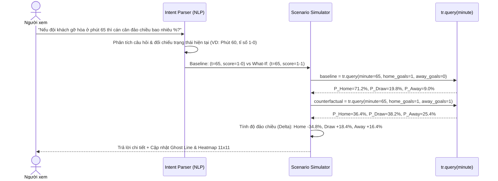

# 🧮 02. Mathematical Logic & `tr.query(minute)` Engine

> Tài liệu này trình bày chi tiết toàn bộ cơ sở toán học đằng sau ứng dụng: cách thiết kế hàm cốt lõi `tr.query(minute)`, cách xây dựng **Ma trận nhiệt tỉ số chính xác 11×11**, cách tính **3 đường xác suất Chủ – Hòa – Khách** từ phút $0 \to 90+$, và thuật toán chuyển đổi câu hỏi tự nhiên trong **What-If Simulator** thành các truy vấn toán học.

---

## 1. Mô Hình Toán Học Cốt Lõi (Inhomogeneous Poisson + Dixon-Coles + Red Card Markov Modulator)

Trong một trận bóng đá kéo dài $T$ phút (thông thường $T = 90 + t_{\text{bù giờ}}$), số bàn thắng ghi thêm của đội Chủ nhà ($H$) và đội Khách ($A$) trong khoảng thời gian còn lại $[t, T]$ tuân theo quá trình Poisson không đồng nhất theo thời gian (Time-Inhomogeneous Bivariate Poisson Process), có điều chỉnh theo trạng thái hiện tại của trận đấu:

$$
\mathcal{S}(t) = \big(t, \; g_H(t), \; g_A(t), \; r_H(t), \; r_A(t)\big)
$$

Trong đó:
- $t \in [0, T]$: Phút thi đấu hiện tại (`minute`).
- $g_H(t), g_A(t) \in \{0, 1, 2, \dots\}$: Số bàn thắng hiện tại của đội Chủ nhà và đội Khách tính đến phút $t$.
- $r_H(t), r_A(t) \in \{0, 1, 2, \dots\}$: Số thẻ đỏ hiện tại của đội Chủ nhà và đội Khách tính đến phút $t$.

### 1.1. Cường Độ Ghi Bàn Kỳ Vọng Trong Thời Gian Còn Lại ($\Lambda_H(t), \Lambda_A(t)$)

Giả sử trước trận đấu (tại $t = 0$), kỳ vọng bàn thắng cả trận của hai đội (lấy từ mô hình Elo/xG hoặc quy đổi từ Asian Handicap / 1X2 pre-match odds) là $\mu_H^0$ và $\mu_A^0$.

Vì tốc độ ghi bàn trong bóng đá thực tế tăng dần về cuối mỗi hiệp (đặc biệt từ phút $75 \to 90+$), ta sử dụng hàm phân phối trọng số thời gian $w(u)$ (hoặc hàm mũ thời gian còn lại $\tau(t) = \left(\frac{T - t}{T}\right)^{\alpha}$ với $\alpha \approx 0.85\text{–}0.92$):

$$
\Lambda_H(t) = \mu_H^0 \cdot \phi_{\text{time}}(t, T) \cdot \gamma_H^{\text{red}}(r_H, r_A) \cdot \psi_H^{\text{score}}(g_H - g_A)
$$

$$
\Lambda_A(t) = \mu_A^0 \cdot \phi_{\text{time}}(t, T) \cdot \gamma_A^{\text{red}}(r_H, r_A) \cdot \psi_A^{\text{score}}(g_H - g_A)
$$

Trong đó:
1. **Hàm tỷ lệ thời gian còn lại $\phi_{\text{time}}(t, T)$**:
   $$\phi_{\text{time}}(t, T) = \max\left(0, \frac{\int_t^T w(u)\,du}{\int_0^T w(u)\,du}\right)$$
   - Tại $t = 0$: $\phi_{\text{time}}(0, T) = 1.0$ (còn nguyên 100% thời gian kỳ vọng).
   - Tại $t = 45$ (hết hiệp 1): $\phi_{\text{time}}(45, 90) \approx 0.55$ (hiệp 2 thường có nhiều bàn thắng hơn hiệp 1 với tỷ lệ ~55% / 45%).
   - Tại $t = T$: $\phi_{\text{time}}(T, T) = 0$.
2. **Hệ số suy giảm / gia tăng do Thẻ Đỏ $\gamma^{\text{red}}(r_H, r_A)$**:
   - Khi đội Chủ nhà nhận $r_H$ thẻ đỏ và đội Khách nhận $r_A$ thẻ đỏ, hiệu số quân số là $\Delta r = r_H - r_A$.
   - Theo thống kê thực nghiệm (Opta / Dixon-Robinson):
     $$\gamma_H^{\text{red}}(r_H, r_A) = \exp(-\beta_{\text{self}} \cdot r_H + \beta_{\text{opp}} \cdot r_A)$$
     $$\gamma_A^{\text{red}}(r_H, r_A) = \exp(-\beta_{\text{self}} \cdot r_A + \beta_{\text{opp}} \cdot r_H)$$
     với $\beta_{\text{self}} \approx 0.38$ (giảm ~32% tốc độ ghi bàn của đội bị thẻ đỏ) và $\beta_{\text{opp}} \approx 0.28$ (tăng ~32% tốc độ ghi bàn của đội đối phương).
3. **Hệ số trạng thái tỉ số $\psi^{\text{score}}(\Delta g)$**:
   - Phản ánh hiệu ứng chiến thuật khi một đội đang dẫn bàn hoặc bị dẫn bàn ở nửa cuối trận đấu.

---

## 2. Xây Dựng Ma Trận Nhiệt Tỉ Số Chính Xác 11×11 ($M \in \mathbb{R}^{11 \times 11}$)

Yêu cầu của ứng dụng là hiển thị **Bản đồ nhiệt tỉ số chính xác $11 \times 11$** ứng với số bàn thắng cuối trận của Chủ nhà $i \in \{0, 1, \dots, 10\}$ và Khách $j \in \{0, 1, \dots, 10\}$ (tổng cộng $11 \times 11 = 121$ ô tỉ số).

### Bước 1: Xác định điều kiện khả thi (Feasibility Mask)
Vì trong bóng đá số bàn thắng không bao giờ giảm đi theo thời gian, tại phút $t$ với tỉ số hiện tại là $(g_H, g_A)$:
- Mọi ô $(i, j)$ có $i < g_H$ **hoặc** $j < g_A$ đều có xác suất bằng **0 tuyệt đối**:
  $$M_{i, j}(t) = 0 \quad \forall \, i < g_H \text{ hoặc } j < g_A$$
- Trên giao diện Heatmap 11×11, các ô này sẽ được khóa (locked/dimmed) để người xem thấy rõ vùng tỉ số nào còn có thể xảy ra.

### Bước 2: Tính xác suất số bàn thắng ghi thêm $(\Delta i, \Delta j)$
Đặt $\Delta i = i - g_H \ge 0$ và $\Delta j = j - g_A \ge 0$ là số bàn thắng hai đội ghi thêm từ phút $t$ đến hết trận. Xác suất cơ sở theo phân phối Poisson độc lập là:

$$
P_{\text{pois}}(\Delta i, \Delta j) = \frac{e^{-\Lambda_H(t)} [\Lambda_H(t)]^{\Delta i}}{\Delta i!} \cdot \frac{e^{-\Lambda_A(t)} [\Lambda_A(t)]^{\Delta j}}{\Delta j!}
$$

### Bước 3: Hiệu chỉnh tương quan Dixon-Coles $\tau_{\rho}(\Delta i, \Delta j)$
Để khắc phục nhược điểm của Poisson thuần túy (thường đánh giá thấp xác suất hòa 0-0 hoặc 1-1), ta nhân thêm hệ số tương quan Dixon-Coles $\tau_{\rho(t)}(\Delta i, \Delta j)$ với $\rho(t) = \rho_0 \cdot \phi_{\text{time}}(t, T)$ (thường $\rho_0 \approx -0.10$):
- Nếu $(\Delta i, \Delta j) = (0, 0)$: $\tau = 1 - \Lambda_H(t)\Lambda_A(t)\rho(t)$
- Nếu $(\Delta i, \Delta j) = (0, 1)$: $\tau = 1 + \Lambda_H(t)\rho(t)$
- Nếu $(\Delta i, \Delta j) = (1, 0)$: $\tau = 1 + \Lambda_A(t)\rho(t)$
- Nếu $(\Delta i, \Delta j) = (1, 1)$: $\tau = 1 - \rho(t)$
- Các trường hợp khác: $\tau = 1.0$.

### Bước 4: Cắt biên $10+$ (Tail Capping) và Chuẩn hóa Ma trận $11 \times 11$
Với các tỉ số nằm ở biên $i = 10$ hoặc $j = 10$, ta cộng dồn phần đuôi xác suất $\ge 10$, sau đó chuẩn hóa toàn bộ ma trận $M \in \mathbb{R}^{11 \times 11}$ sao cho:

$$
\sum_{i=0}^{10} \sum_{j=0}^{10} M_{i,j}(t) = 1.0 \quad (100\%)
$$

### Bước 5: Suy ra 3 đường xác suất Chủ – Hòa – Khách từ Ma trận $11 \times 11$
Từ ma trận $M_{i,j}(t)$, 3 xác suất kết quả trận đấu được tính hoàn toàn nhất quán:
- **Xác suất Chủ thắng ($P_{\text{Home}}$)**: Tổng tam giác dưới đường chéo chính:
  $$P_{\text{Home}}(t) = \sum_{i=0}^{10} \sum_{j=0}^{i-1} M_{i,j}(t)$$
- **Xác suất Hòa ($P_{\text{Draw}}$)**: Tổng đường chéo chính:
  $$P_{\text{Draw}}(t) = \sum_{i=0}^{10} M_{i,i}(t)$$
- **Xác suất Khách thắng ($P_{\text{Away}}$)**: Tổng tam giác trên đường chéo chính:
  $$P_{\text{Away}}(t) = \sum_{i=0}^{10} \sum_{j=i+1}^{10} M_{i,j}(t)$$

> **Ưu điểm tuyệt đối của thiết kế này**: Nhờ tính $P_{\text{Home}}, P_{\text{Draw}}, P_{\text{Away}}$ trực tiếp từ tổng các vùng của ma trận $11 \times 11$, số liệu trên **Biểu đồ Ribbon**, **Chatbot What-If**, và **Bản đồ nhiệt 11×11** luôn khớp nhau 100% đến từng chữ số thập phân!

---

## 3. Đặc Tả Kỹ Thuật Hàm `tr.query(minute, ...)`

Trong file [`backend/app/engine/trajectory.py`](file:///home/antigravity/72finalboss/football_app/backend/app/engine/trajectory.py), đối tượng `tr` (`TrajectoryEngine`) sẽ được thiết kế với chữ ký hàm chuẩn để có thể vừa dùng cho Live Stream vừa dùng cho What-If Simulator:

```python
class TrajectoryEngine:
    def __init__(
        self,
        lambda_home_pre: float = 1.55,
        lambda_away_pre: float = 1.20,
        rho: float = -0.10,
        total_minutes: int = 90,
        events: list[MatchEvent] | None = None,
    ):
        ...

    def query(
        self,
        minute: float,
        home_goals: int | None = None,
        away_goals: int | None = None,
        home_reds: int | None = None,
        away_reds: int | None = None,
        added_time: int = 0,
    ) -> TrajectoryQueryResult:
        """
        Truy vấn xác suất thắng/hòa/thua và ma trận tỉ số 11x11 tại phút `minute`.
        - Nếu chỉ truyền `tr.query(minute)` mà không truyền tỉ số/thẻ đỏ:
          Hàm tự động suy ra tỉ số và thẻ đỏ thực tế tại phút `minute` từ lịch sử sự kiện trận đấu ( hoặc giữ nguyên trạng thái hiện tại nếu `minute` ở tương lai).
        - Nếu truyền kèm `home_goals`, `away_goals`, `home_reds`, `away_reds`:
          Hàm tính toán xác suất cho kịch bản giả định ("What-If") tại phút `minute`.
        """
```

### Cấu trúc dữ liệu trả về của `tr.query(minute)` (`TrajectoryQueryResult`):
```json
{
  "minute": 65,
  "state": {
    "home_goals": 1,
    "away_goals": 1,
    "home_reds": 0,
    "away_reds": 0
  },
  "remaining_xg": {
    "home": 0.482,
    "away": 0.374
  },
  "probabilities": {
    "home_win": 0.3642,
    "draw": 0.3815,
    "away_win": 0.2543
  },
  "score_matrix_11x11": [
    [0.0, 0.0, "... (11 cột từ 0 đến 10 bàn của đội khách)"],
    "... (11 hàng từ 0 đến 10 bàn của đội chủ nhà)"
  ],
  "top_exact_scores": [
    { "score": "1-1", "probability": 0.3381 },
    { "score": "2-1", "probability": 0.1945 },
    { "score": "1-2", "probability": 0.1510 }
  ]
}
```

---

## 4. Logic Hoạt Động Của "What-If Simulator" Chatbot

Khi người dùng nhập một câu hỏi vào Chatbot, hệ thống xử lý qua **Pipeline 3 bước** trong mô-đun `backend/app/chatbot/`:



### Hai kịch bản mẫu điển hình theo yêu cầu:

#### Kịch bản 1: *"Nếu đội khách gỡ hòa ở phút 65 thì cán cân đảo chiều bao nhiêu %?"*
- **Trạng thái hiện tại**: Đội chủ nhà đang dẫn $1\text{–}0$ (hoặc $k\text{–}(k-1)$).
- **Bước 1 (Parser)**: Nhận diện hành động `"đội khách gỡ hòa"` $\implies g_A^{\text{whatif}} = g_H^{\text{current}}$, thời điểm `minute = 65`.
- **Bước 2 (Simulator)**:
  - Gọi `base = tr.query(65, home_goals=1, away_goals=0)` $\to P_H = 71.2\%, P_D = 19.8\%, P_A = 9.0\%$.
  - Gọi `sim = tr.query(65, home_goals=1, away_goals=1)` $\to P_H = 36.4\%, P_D = 38.2\%, P_A = 25.4\%$.
- **Bước 3 (Kết quả)**:
  - Xác suất Chủ thắng **giảm mạnh $-34.8\%$** (từ $71.2\% \to 36.4\%$).
  - Xác suất Hòa **tăng $+18.4\%$** (từ $19.8\% \to 38.2\%$).
  - Xác suất Khách thắng **tăng $+16.4\%$** (từ $9.0\% \to 25.4\%$).

#### Kịch bản 2: *"Nếu giữ nguyên tỉ số 1-0 này đến phút 75 thì xác suất thắng tăng từ 68% lên bao nhiêu %?"*
- **Trạng thái hiện tại**: Phút $t_{\text{now}}$ (ví dụ phút 58), tỉ số đang là $1\text{–}0$, xác suất Chủ thắng hiện tại là $68.0\%$.
- **Bước 1 (Parser)**: Nhận diện hành động `"giữ nguyên tỉ số 1-0"`, thời điểm đích `minute = 75`.
- **Bước 2 (Simulator)**:
  - Gọi `now = tr.query(t_now, home_goals=1, away_goals=0)` ($P_H \approx 68.0\%$).
  - Gọi `sim = tr.query(75, home_goals=1, away_goals=0)` $\to$ Khi thời gian trôi đến phút 75 mà không thủng lưới, kỳ vọng bàn thắng còn lại của đội khách $\Lambda_A(75)$ giảm mạnh, đẩy $P_H(75)$ lên **$79.6\%$** (tăng **+$11.6\%$**).
  - Ngoài ra, Simulator có thể tính thêm xác suất điều kiện: *"Xác suất để tỉ số 1-0 thực sự được giữ nguyên từ phút 58 đến phút 75 là $\exp(-(\Delta \Lambda_H + \Delta \Lambda_A)) \approx 64.2\%$"*.
