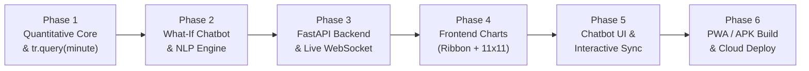

# 🗺️ 04. Implementation Roadmap (Kế Hoạch Thực Thi Chi Tiết)

> Tài liệu này trả lời câu hỏi: **"Bạn sẽ làm những gì để build lên app này?"** bằng cách chia nhỏ quá trình phát triển thành 6 giai đoạn (Phases) tuần tự, mỗi giai đoạn có đầu ra (Deliverables) và tiêu chí nghiệm thu rõ ràng.

---

## Tổng Quan Lộ Trình 6 Giai Đoạn

---

## Phase 1: Xây Dựng Lõi Toán Học & Hàm `tr.query(minute)` (`backend/app/engine/`)

**Mục tiêu**: Xây dựng bộ máy tính toán xác suất chính xác tuyệt đối, tốc độ phản hồi `<2ms`, hoàn toàn độc lập với giao diện.

1. **Xây dựng `poisson_dixon_coles.py`**:
   - Cài đặt hàm tính phân phối Poisson hai chiều vector hóa bằng NumPy cho lưới $11 \times 11$ ($\Delta i, \Delta j \in \{0 \dots 10\}$).
   - Cài đặt ma trận hiệu chỉnh tương quan tỉ số thấp Dixon-Coles $\tau_{\rho}(\Delta i, \Delta j)$.
2. **Xây dựng `markov_red_card.py`**:
   - Cài đặt hàm điều chỉnh cường độ ghi bàn $\gamma^{\text{red}}(r_H, r_A)$ khi có thẻ đỏ từ một hoặc cả hai đội.
   - Cài đặt đường cong trọng số thời gian thi đấu $\phi_{\text{time}}(t, T)$ cho phút $0 \to 90+$.
3. **Xây dựng `score_matrix.py`**:
   - Dịch chuyển (shift) ma trận bàn thắng ghi thêm theo tỉ số hiện tại $(g_H, g_A)$.
   - Áp dụng mặt nạ bất khả thi (Feasibility Mask: gán $0$ cho mọi ô $i < g_H$ hoặc $j < g_A$), gom phần đuôi vào biên $10$ và chuẩn hóa tổng ma trận $11 \times 11$ bằng đúng $1.0$.
4. **Xây dựng `trajectory.py` (Class `TrajectoryEngine` & `tr.query(minute)`)**:
   - Đóng gói hàm `tr.query(minute, home_goals, away_goals, home_reds, away_reds, added_time)`.
   - Tính toán đồng thời 3 xác suất `home_win`, `draw`, `away_win` và ma trận `score_matrix_11x11`.
5. **Xây dựng `momentum.py`**:
   - Hàm sinh trọn bộ chuỗi xác suất từ phút $0$ đến phút hiện tại dựa trên danh sách sự kiện trận đấu (Bàn thắng, Thẻ đỏ) để vẽ biểu đồ Ribbon.
6. **Kiểm thử (`tests/test_tr_query.py`, `tests/test_score_matrix_11x11.py`)**:
   - Kiểm tra tính chất bất biến: tổng 121 ô luôn bằng $100\%$, xác suất thắng tăng đơn điệu khi giữ nguyên lợi thế dẫn bàn về cuối trận.

---

## Phase 2: Xây Dựng Bộ Não "What-If Simulator" Chatbot (`backend/app/chatbot/`)

**Mục tiêu**: Cho phép người dùng hỏi bằng tiếng Việt tự nhiên và nhận về kết quả định lượng chính xác từ `tr.query(minute)`.

1. **Xây dựng `intent_parser.py` (Hybrid NLP Parser)**:
   - **Tầng Regex / Rule-based Tiếng Việt**: Nhận diện tức thì các mẫu câu:
     - *Gỡ hòa*: `"gỡ hòa"`, `"san bằng tỉ số"`, `"đưa trận đấu về vạch xuất phát"` ở phút `X`.
     - *Giữ nguyên tỉ số*: `"giữ nguyên tỉ số"`, `"bảo toàn tỉ số"`, `"tử thủ đến phút X"`.
     - *Ghi thêm bàn*: `"ghi thêm N bàn"`, `"nâng tỉ số lên A-B"`, `"vươn lên dẫn trước"` ở phút `X`.
     - *Thẻ đỏ*: `"bị thẻ đỏ"`, `"mất người"`, `"chơi thiếu người"` ở phút `X`.
   - **Tầng LLM Function Calling Fallback (`prompts.py`)**: Định nghĩa JSON Schema cho công cụ `simulate_what_if_scenario` để xử lý mọi câu hỏi biến thể tự do.
2. **Xây dựng `scenario_simulator.py`**:
   - Thực thi cặp lệnh gọi:
     - `baseline = tr.query(minute_ref, current_state)`
     - `counterfactual = tr.query(minute_target, simulated_state)`
   - Tính toán vector biến thiên $\Delta P = (\Delta P_H, \Delta P_D, \Delta P_A)$ và ma trận chênh lệch $\Delta M_{11\times 11}$.
3. **Xây dựng `response_generator.py`**:
   - Tạo câu trả lời tự nhiên, sắc sảo như một bình luận viên phân tích dữ liệu (VD: *"Nếu đội khách gỡ hòa 1-1 ở phút 65, xác suất thắng của đội chủ nhà sẽ sụt giảm **34.8%** (từ **71.2%** xuống chỉ còn **36.4%**), trong khi cửa Hòa vọt lên **38.2%**..."*).

---

## Phase 3: Xây Dựng Backend API & Real-Time Streaming (`backend/app/api/` & `services/`)

**Mục tiêu**: Cung cấp dữ liệu thời gian thực và API tốc độ cao cho ứng dụng Web/Mobile.

1. **Xây dựng `live_feed_ingestor.py`**:
   - Kết nối API dữ liệu bóng đá trực tiếp + Bộ giả lập trận đấu trực tiếp (Live Match Replay Simulator) có sẵn 3 trận cầu kinh điển (kịch bản lội ngược dòng, kịch bản thẻ đỏ, kịch bản bảo toàn tỉ số) để người dùng test bất kỳ lúc nào.
2. **Xây dựng `routes_match.py`, `routes_whatif.py`, `ws_live.py`**:
   - REST API lấy chi tiết trận đấu, chuỗi Ribbon và Heatmap 11×11.
   - REST API `POST /api/v1/matches/{id}/what-if` cho Chatbot.
   - WebSocket `/ws/matches/{id}` đẩy dữ liệu xác suất mỗi khi đồng hồ trận đấu nhảy phút hoặc có biến cố.

---

## Phase 4: Xây Dựng Giao Diện Biểu Đồ Trực Quan (`frontend/src/components/charts/`)

**Mục tiêu**: Hiển thị trực quan, sắc nét trên cả màn hình điện thoại và máy tính.

1. **Xây dựng `LiveProbabilityRibbon.tsx`**:
   - Vẽ 3 đường xác suất Chủ – Hòa – Khách chạy mượt từ phút $0 \to 90+$.
   - Tích hợp `EventTimelineMarkers.tsx` gắn các icon `⚽` (Bàn thắng) và `🟥` (Thẻ đỏ) tại đúng phút xảy ra sự kiện kèm hiệu ứng sóng (pulse animation).
   - Hỗ trợ vẽ đường nét đứt (Ghost Trajectory) khi người dùng đang kích hoạt một kịch bản What-If.
2. **Xây dựng `ScoreMatrixHeatmap11x11.tsx`**:
   - Xây dựng lưới ma trận $11 \times 11$ ($0\text{–}10 \times 0\text{–}10$) với 3 vùng màu trực quan (Chủ thắng / Hòa / Khách thắng).
   - Làm mờ các ô tỉ số không còn khả thi ($i < g_H$ hoặc $j < g_A$).
   - Hiển thị huy hiệu (Badge) cho Top 3 tỉ số có xác suất cao nhất và hỗ trợ chạm vào từng ô để xem chi tiết.

---

## Phase 5: Xây Dựng Giao Diện Chatbot & Đồng Bộ Tương Tác (`frontend/src/components/whatif/`)

**Mục tiêu**: Kết nối trải nghiệm hỏi đáp Chatbot với sự thay đổi trực quan trên biểu đồ.

1. **Xây dựng `WhatIfChatWidget.tsx`, `QuickScenarioChips.tsx`, `ProbabilitySwingCard.tsx`**:
   - Giao diện khung chat hiện đại, có sẵn các nút gợi ý kịch bản 1 chạm theo diễn biến thực tế trên sân.
   - Hiển thị thẻ so sánh phần trăm đảo chiều ($\Delta \%$) rõ ràng.
2. **Đồng bộ hóa 2 chiều (`useWhatIfSimulator.ts`)**:
   - Khi Chatbot trả lời xong một kịch bản ở phút $t_{\text{sim}}$, người dùng bấm vào thẻ kết quả sẽ thấy ngay điểm đó sáng lên trên **Biểu đồ Ribbon** và **Heatmap 11×11** chuyển sang hiển thị ma trận của kịch bản giả lập.

---

## Phase 6: Đóng Gói Mobile App (PWA + APK/IPA) & Triển Khai Cloud

**Mục tiêu**: Đưa sản phẩm đến tay người dùng cuối để tải về điện thoại hoặc truy cập trực tiếp.

1. Cấu hình **PWA (`manifest.json`, `sw.js`)** đạt chuẩn Installable Web App trên iOS Safari & Android Chrome.
2. Cấu hình **Capacitor (`capacitor.config.ts`)** để xuất file cài đặt **Android `.apk`** và dự án **iOS Xcode**.
3. Đóng gói Docker (`Dockerfile`, `docker-compose.yml`) và triển khai lên Cloud (chi tiết tại file số 05).
