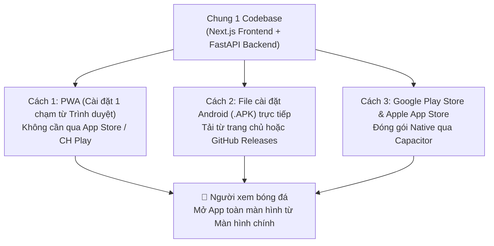

# 🚀 05. Deployment & User Distribution Strategy

> Tài liệu này trả lời chi tiết câu hỏi: **"Làm sao để deploy để người dùng có thể tải về và sử dụng trực tiếp?"** trên cả thiết bị di động (Android / iOS) lẫn máy tính (Web / Desktop).

---

## 1. Ba Phương Thức Để Người Dùng Tải Về Và Sử Dụng Trực Tiếp

Đối với một ứng dụng phục vụ người xem bóng đá trực tiếp (thường cầm điện thoại khi đang xem TV hoặc tại sân vận động), chúng ta triển khai đồng thời **3 kênh phân phối** từ cùng một bộ mã nguồn:



### Cách 1: Progressive Web App (PWA) — Nhanh nhất, cài trên cả iOS & Android không cần chợ ứng dụng
- **Cách hoạt động**:
  - Ứng dụng được cấu hình sẵn file [`frontend/public/manifest.json`](file:///home/antigravity/72finalboss/football_app/frontend/public/manifest.json) (`"display": "standalone"`) và Service Worker [`frontend/public/sw.js`](file:///home/antigravity/72finalboss/football_app/frontend/public/sw.js).
  - Khi người dùng truy cập đường link ứng dụng (ví dụ `https://liveprob-football.vercel.app`) trên điện thoại, một banner **"📲 Tải App về màn hình chính"** sẽ hiện ra.
- **Trải nghiệm người dùng**:
  - **Trên Android (Chrome)**: Bấm nút **"Cài đặt ứng dụng" (Install App)** $\to$ Tự động tạo icon ngoài màn hình chính trong 2 giây, mở lên toàn màn hình không có thanh địa chỉ trình duyệt, nhận thông báo (Push Notification) khi có bàn thắng/thẻ đỏ.
  - **Trên iPhone / iOS (Safari)**: Bấm nút **Chia sẻ (Share)** $\to$ **"Thêm vào MH chính" (Add to Home Screen)** $\to$ Chạy mượt mà như ứng dụng iOS gốc.

### Cách 2: Phát hành File `.APK` trực tiếp cho Android (Direct Download)
- **Cách hoạt động**:
  - Sử dụng **Capacitor** (cấu hình trong [`frontend/capacitor.config.ts`](file:///home/antigravity/72finalboss/football_app/frontend/capacitor.config.ts)) kết hợp **GitHub Actions CI/CD** để tự động biên dịch bản build giao diện thành file cài đặt `football-live-prob-v1.0.apk`.
  - File `.apk` này được gắn trực tiếp vào nút **"Tải về cho Android (.APK)"** ngay trên trang chủ web và mục **GitHub Releases** của repository.
- **Trải nghiệm người dùng**:
  - Người dùng Android chỉ cần bấm tải file `.apk` về máy và bấm **Cài đặt** để sử dụng ngay lập tức mà không cần đợi duyệt trên Google Play.

### Cách 3: Phát hành lên Google Play Store (`.AAB`) & Apple App Store (`.IPA`)
- Khi lượng người dùng tăng cao, cùng cấu hình Capacitor đó cho phép xuất ra:
  - **Android App Bundle (`.aab`)** để đăng tải lên **Google Play Console**.
  - **iOS Archive (`.ipa`)** qua Xcode để phân phối qua **TestFlight** hoặc **Apple App Store**.

---

## 2. Kiến Trúc Hạ Tầng Cloud Deployment (Production)

Để ứng dụng hoạt động ổn định, chịu tải tốt khi có hàng ngàn người cùng xem một trận cầu tâm điểm (như Ngoại Hạng Anh, Champions League, Đội tuyển Việt Nam), hạ tầng Cloud được bố trí như sau:

| Thành phần | Nền tảng Cloud đề xuất | Cấu hình & Ưu điểm |
| :--- | :--- | :--- |
| **Frontend Web & PWA** | **Vercel** hoặc **Cloudflare Pages** | Tự động deploy mỗi khi `git push` lên nhánh `main` của GitHub. Hỗ trợ CDN toàn cầu, HTTPS mặc định (bắt buộc cho PWA). |
| **Backend FastAPI & WebSocket** | **Railway** / **Render** / **Fly.io** | Chạy container từ [`backend/Dockerfile`](file:///home/antigravity/72finalboss/football_app/backend/Dockerfile). Hỗ trợ kết nối **WebSockets (WSS)** lâu dài cho biểu đồ Live Probability Ribbon. |
| **In-Memory Cache** | **Upstash Redis** (Serverless Redis) | Lưu trạng thái trận đấu và cache kết quả `tr.query(minute)` với độ trễ cực thấp, có gói Free Tier rộng rãi. |
| **Database** | **Supabase** hoặc **Neon** (Managed PostgreSQL) | Lưu trữ lịch sử các trận đấu, sự kiện bàn thắng/thẻ đỏ và log câu hỏi What-If. |
| **Auto Build APK** | **GitHub Actions** | Tự động chạy lệnh build Capacitor và xuất file `.apk` vào mục Releases của repo `72finalboss/football_app`. |

---

## 3. Quy Trình Các Bước Deploy Thực Tế

### Bước 1: Chạy thử nghiệm toàn bộ hệ thống bằng 1 lệnh Docker (`Local / VPS`)
Nhờ file [`docker-compose.yml`](file:///home/antigravity/72finalboss/football_app/docker-compose.yml) ở thư mục gốc của repo, bạn hoặc bất kỳ lập trình viên nào có thể dựng toàn bộ Backend + Frontend + Redis chỉ với 1 lệnh:
```bash
docker compose up --build -d
```
- **Web / PWA App**: Hoạt động tại cổng `3000`.
- **FastAPI Backend & Swagger Docs**: Hoạt động tại cổng `8000` (`/docs`).

### Bước 2: Deploy Backend lên Railway / Render
1. Đăng nhập Railway.app hoặc Render.com bằng tài khoản GitHub.
2. Chọn repository `72finalboss/football_app`, trỏ thư mục gốc vào `/backend`.
3. Thiết lập các biến môi trường:
   - `REDIS_URL`: Đường dẫn Redis.
   - `FOOTBALL_API_KEY`: Khóa API dữ liệu bóng đá trực tiếp (hoặc bật `ENABLE_DEMO_REPLAY=true`).
   - `LLM_API_KEY`: Khóa API Gemini/OpenAI (tùy chọn cho câu hỏi phức tạp).
4. Nhận về URL Backend: `https://api-football-prob.up.railway.app`.

### Bước 3: Deploy Frontend & PWA lên Vercel
1. Kết nối repo `72finalboss/football_app` với Vercel, chọn Root Directory là `/frontend`.
2. Cài đặt biến môi trường:
   - `NEXT_PUBLIC_API_URL=https://api-football-prob.up.railway.app`
   - `NEXT_PUBLIC_WS_URL=wss://api-football-prob.up.railway.app`
3. Sau 60 giây, Vercel cấp đường link HTTPS chính thức. Người dùng mở link này trên điện thoại là có thể **bấm cài đặt PWA về máy dùng trực tiếp**.

### Bước 4: Đóng gói file `.APK` cho Android bằng Capacitor
```bash
cd frontend
npm run build
npx cap sync android
cd android && ./gradlew assembleRelease
```
File `app-release.apk` sinh ra có thể gửi trực tiếp cho người dùng tải về điện thoại Android hoặc đính kèm lên trang chủ ứng dụng.
